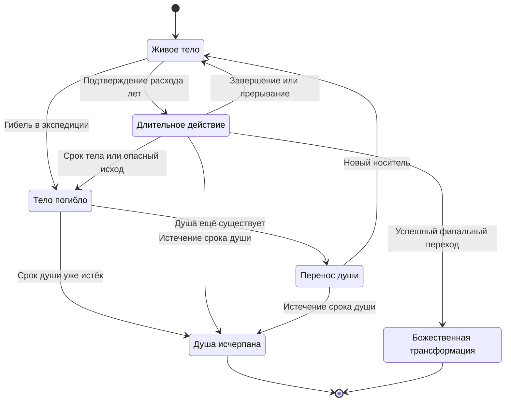

# 13. Состояние игры, данные и сохранение

**ID:** STATE · **Версия:** 0.1.0 · **Статус:** ACCEPTED для игровых инвариантов; конкретные границы записей и обработки — PROPOSAL.

Это контракт наблюдаемого поведения между системами. Он не предписывает окончательные имена классов, дерево сцен, библиотеку сохранения или устройство файлов Godot. Профильные правила остаются в документах [03](03-time-soul-and-reincarnation.md)–[08](08-npcs-quests-and-sects.md).

## STATE-01. Границы ответственности

**PROPOSAL:** правила симуляции изменяют явное состояние; 3D-сцена представляет это состояние и отправляет намерения игрока; определения контента задают допустимые методы, объекты и события. Удаление или повторная загрузка сцены само по себе не является игровым событием рождения ресурса или NPC.

| Запись | Владеет | Не должна владеть |
|---|---|---|
| `CampaignState` | Идентичностью кампании, датой старта, текущей датой, режимом, активным телом, версиями данных | Физическими параметрами каждого экземпляра меша |
| `SoulState` | Прошедшими годами, пределом, впервые достигнутыми рубежами, отпечатками знаний, историей тел | Полным боевым уровнем погибшего тела как готовой силой нового |
| `BodyState` | Возрастом, стадией, накоплением, устойчивостью, особенностями, травмами, текущими навыками и экипировкой | Общим seed мира и долгами всех организаций |
| `WorldState` | Состояниями мест, ролями и людьми, ресурсами, хранилищами, организациями, календарными последствиями | Недатированной всеведущей картой игрока |
| `KnowledgeRecord` | Содержанием наблюдения, источником и датой; уровнем освоения и переносимым отпечатком | Автоматически актуальным состоянием ещё не обследованной области |
| `LongActionState` | Методом, этапом, фактической длительностью, расходами, прогрессом и причиной остановки | Независимым параллельным календарём, расходующим время второй раз |
| `ResourceInstance` / `ItemInstance` | Конкретной идентичностью и физическим состоянием источника либо предмета | Шаблоном бесконечно возобновляемой добычи |
| `QuestState` / `ContractState` | Сторонами, условиями, целью, выполнением, наградой и завершением | Личностью нового хозяина роли по совпадению локации |

Примерные поля в [JSON](../examples/README.md) иллюстрируют смысл. Производственная схема должна пройти отдельный этап утверждения и версионирования.

## STATE-02. Идентификатор определения и экземпляра

`glass_root` как тип растения отличается от конкретного источника `white_sedge.root.001`. Рецепт ссылается на свойства материалов, а инвентарь — на конкретные экземпляры и количества. Новому торговцу даётся новый `npc_id`; торговая роль может иметь прежний `role_id`.

**PROPOSAL:** каждый значимый объект имеет устойчивый ID, историю переходов или достаточное сохранённое состояние для их воспроизведения. Ссылки на отсутствующий объект не должны молча создавать его заново. Смерть человека закрывает личность, но не уничтожает сведения о нём и журнал прошлых действий.

## STATE-03. Календарные инварианты

Для базовой модели без специальных временных эффектов:

```text
campaign_year = current_world_year - start_world_year
soul_elapsed_years = campaign_year
body_age_years = body_age_at_entry + current_world_year - body_entry_world_year
soul_remaining_years = soul_lifespan_cap_years - soul_elapsed_years
body_remaining_years = body_lifespan_cap_years - body_age_years
```

Формулы описывают принятый смысл времени. Во время переноса активного тела может не быть; формула возраста тела тогда не применяется. Косметическое освещение и физический шаг боя не меняют `current_world_year`.

Предел души — максимум пределов уже впервые закреплённых личных рубежей, включая стартовый. В новом теле прежняя стадия может увеличить предел тела, но не душевный максимум. Получение нового предела разрешено только пока соответствующая жизнь не истекла. Точность и совпадения дат — [OPEN-01](16-open-questions-and-risks.md).

**PROPOSAL для VS-01:** целочисленные календарные годы достаточно точны для первых примеров. Не накапливать возраст дробными прибавками каждого кадра. Если позднее понадобятся месяцы, мигрировать единую единицу календаря; не смешивать округлённый интерфейс и фактически иной момент смерти.

## STATE-04. Намерение, прогноз и подтверждение

Команда игрока описывает намерение: начать практику, извлечь объект определённым способом, купить имеющуюся услугу, применить технику. Проверка возможности и прогноз не должны сами расходовать ресурсы, двигать календарь или перебирать случайные исходы.

**PROPOSAL:** прогноз включает версию наблюдаемого состояния. При подтверждении система снова проверяет тело, наличие материала, источник и договор. Если мир существенно изменился с момента прогноза, игрок получает обновлённый результат перед расходом. Устаревший экран не даёт права купить уже исчезнувшую пилюлю.

После подтверждения операция фиксирует ID, выбранный метод, входные экземпляры и точки расхода. Пересылка одной и той же команды из-за восстановления интерфейса или загрузки не должна совершать покупку дважды. Это требование идемпотентности значимых операций, а не обязательство журналировать каждое движение персонажа.

## STATE-05. Разрешение длительного действия

Наблюдаемый порядок:

1. Проверить условия и подтвердить намерение с явным сроком и стоимостью.
2. Зафиксировать начальные расходы по методу. Не расходовать заранее предмет, нужный только в необязательной будущей фазе.
3. Определить ближайшую из границ: календарное событие, конец этапа, исчерпание жизни или заявленное прерывание.
4. Продвинуть дату и возраст ровно до этой границы. Начислить фактический прогресс по правилам этапа.
5. Разрешить последствия в согласованном порядке; при необходимости остановиться для решения игрока и сохранить именно эту дату.
6. Продолжить следующий этап либо завершить операцию. Зафиксировать итог и использованные материалы один раз.

Не все действия накапливают результат линейно: изучение принципа, стабилизация и испытание могут иметь разные точки закрепления. Метод должен явно описывать, что остаётся при остановке. Линейное начисление «процентов от всех наград» не является универсальным правилом.

**PROPOSAL для совпадений:** сначала истечение жизни, затем последствия мира и договоров, затем закрепление ещё допустимого действия. Окончательный порядок нескольких одновременных событий остаётся открытым. Прототип обязан применять выбранную политику последовательно и иметь отдельный сценарий её проверки.

## STATE-06. Календарь и события

Событие имеет условие допустимости, дату либо детерминированный способ её определения и устойчивую идентичность. После применения оно помечено совершённым; загрузка не создаёт повторной смерти, награды или нападения.

Мировые события разрешаются хронологически, но знание игрока обновляется только через доступный канал. Изменённое русло может существовать в `WorldState`, пока старая карта остаётся прежней датированной записью. Важное объявленное обязательство может остановить уединение на своём году.

Если игрок не менял условия между четырьмя периодами по пять лет, фоновые события за те же двадцать лет не получают четыре новых шанса. Допустима разница в расходах самой практики, если отдельные старты имеют объявленную стоимость; это не разрешает менять историю мира произвольным дроблением.

## STATE-07. Смерть как единый переход состояния

При гибели тела последовательно фиксируются причина и дата, прекращение физического развития, положение имущества и применимые договорные последствия, сохранение заработанных отпечатков. Активная команда или уединение больше не исполняются телом. При живой душе начинается перенос; время мира продолжает идти.

Новое тело получает новый ID, собственный возраст и параметры. Сохранённое знание даёт только оговорённую основу. Тайник, покинутые вещи, неизвестные события и торговые запасы не обновляются. Старые выполненные последствия заданий остаются в мире.

Если срок души истёк во время переноса, новое тело не выдаётся задним числом. Не добавляется отдельная случайная проверка окончательной смерти души. Конечное состояние кампании сохраняется так же устойчиво, как успешный прорыв.

Схема показывает жизненный цикл кампании, а не обязательный набор программных классов:



Переход `Transfer → Alive` не меняет seed и не начисляет новые годы к пределу души. Возвращение из практики не создаёт мир заново.

## STATE-08. Случайность и сохранённые результаты

**ACCEPTED:** перезагрузка не даёт бесплатного нового исхода уже принятого решения и не меняет ранее созданный мир.

**PROPOSAL:** отделить области случайности генерации мира, календаря, добычи, прорывов, боя и косметики. Сохранить seed, состояния необходимых потоков и результаты уже совершённых значимых операций. Случайный звук или частица не должны менять следующую редкую находку.

Не требуется детерминированно воспроизводить всю физику боя по одному seed. Требуется сохранить значимые результаты и состояние выбранного подхода к продолжению боя. Политика сохранения в середине динамической атаки — отдельный [OPEN-10](16-open-questions-and-risks.md).

Открытие прогноза, обычный взгляд на источник и повторная загрузка интерфейса не являются значимыми новыми обстоятельствами для броска. Новая квалификация, другой инструмент, существенная смена среды или отдельная оплаченная попытка могут быть новым допустимым действием по правилам системы.

## STATE-09. Сохранение и восстановление

Принята одна текущая линия кампании, которую можно прекращать и продолжать. Это не запрет пользоваться компьютером свободно и не повод вводить сетевую проверку честности. Игрок не должен оставлять приложение открытым на реальное время уединения.

**PROPOSAL:** сохранять согласованный снимок с версией схемы и набора контента, датой, активным телом, душой, объектами мира, задачами, состояниями случайности и незавершённой значимой операцией. Сохранение должно либо целиком подтверждаться, либо оставлять предыдущий согласованный снимок. Неполный снимок не допускает дублирования покупки, списания или награды.

Резервная копия для восстановления повреждённого файла допустима как техническая защита данных. Она не является игровым меню выбора лучшего результата броска. При изменении схемы поддержка старого сохранения объявляется явно; неизвестные поля или ID нельзя молча заменить сильным стартовым персонажем.

**OPEN:** поведение продолжения непосредственно в бою, число внутренних резервных копий, формат файла, миграции версий и политика совместимости обновлений. VS-01 проверяет согласованный календарный снимок; выпуск полноценного боя требует собственного решения о продолжении.

## STATE-10. Минимальные логические контракты систем

| Операция | Вход по смыслу | Результат, который обязан быть явным |
|---|---|---|
| Прогноз длительного действия | Тело, цель, метод, материалы, место, обязательства | Срок, границы риска, расходы, известные последствия, допустимость |
| Подтверждение и продвижение | Тот же выбор и актуальное состояние | Фактическая дата, этап, расходы, прогресс, событие или итог |
| Обследование источника | Наблюдатель, его чувства, знания, источник | Новые обоснованные сведения либо отсутствие новой информации |
| Извлечение | Источник, способ, инструмент, контейнер, квалификация | Изменённый источник и конкретные полученные материалы |
| Разрешение задания | Стороны, условие цели, предъявленные доказательства | Состояние цели, доступность сдачи, расход доказательств, выданная награда |
| Смерть и перенос | Тело, причина, дата, остаток души | Имущество в мире, отпечатки, сроки, новая оболочка либо завершение кампании |

На этих границах нужны устойчивые проверки. Конкретные классы и методы выбираются после знакомства с кодом проекта; универсальная система событий ради всех мыслимых расширений не требуется.

## STATE-11. Проверки данных и отладка

Режим разработки может выводить причины генерации, использованные случайные значения, скрытые даты и переходы. Эти сведения не должны автоматически попадать в игровой интерфейс. Отладочное принуждение смерти или успеха явно отличается от обычной кампании.

Проверяются уникальность экземпляров, существование ссылок, согласованность возраста, запрет отрицательного имущества, допустимые переходы задач и соответствие сохранения версии. [Примеры](../examples/README.md) и [сценарии приёмки](14-acceptance-scenarios.md) задают исходные случаи; сама проверка документации не является тестом будущей реализации.
