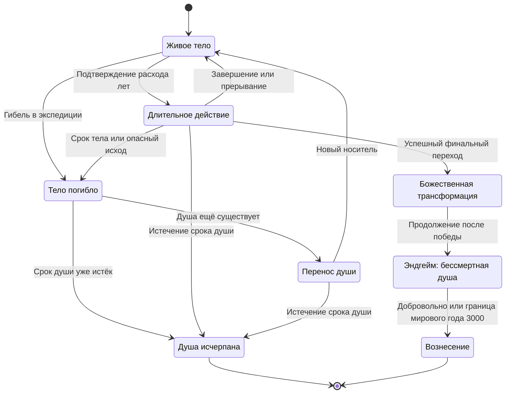

# 13. Состояние игры, данные и сохранение

**ID:** STATE · **Версия:** 0.14.1 · **Статус:** ACCEPTED для игровых инвариантов; конкретные границы записей и обработки — PROPOSAL.

Это контракт наблюдаемого поведения между системами. Он не предписывает окончательные имена классов, дерево сцен, библиотеку сохранения или устройство файлов Godot. Свод пространства и времени — [21](21-space-time-and-regional-calendar.md). Профильные правила остаются в документах [03](03-time-soul-and-reincarnation.md)–[08](08-npcs-quests-and-sects.md).

## STATE-01. Границы ответственности

**PROPOSAL:** правила симуляции изменяют явное состояние; 3D-сцена представляет это состояние и отправляет намерения игрока; определения контента задают допустимые методы, объекты и события. Удаление или повторная загрузка сцены само по себе не является игровым событием рождения ресурса или NPC.

| Запись | Владеет | Не должна владеть |
|---|---|---|
| `CampaignState` | Идентичностью кампании, датой старта, текущей датой, режимом, активным телом, версиями данных | Физическими параметрами каждого экземпляра меша |
| `SoulState` | Прошедшими днями, пределом, победой/бессмертием, законами и основой билда, впервые достигнутыми рубежами, освоением знаний, Разумом, Контролем, Сосредоточением, историей тел | Полным боевым уровнем погибшего тела как готовой силой нового |
| `BodyState` | Возрастом, стадией, накоплением, устойчивостью, особенностями, травмами, действующим методом, корнями, телесными характеристиками, текущей энергией и экипировкой | Общим seed мира и долгами всех организаций |
| `WorldState` | Состояниями мест, ролями и людьми, ресурсами, хранилищами, организациями, календарными последствиями | Недатированной всеведущей картой игрока |
| `KnowledgeRecord` | Содержанием наблюдения, источником и датой; сохранённым уровнем освоения | Автоматически актуальным состоянием ещё не обследованной области |
| `LongActionState` | Методом, этапом, фактической длительностью, расходами, прогрессом и причиной остановки | Независимым параллельным календарём, расходующим время второй раз |
| `ResourceInstance` / `ItemInstance` | Конкретной идентичностью и физическим состоянием источника либо предмета | Шаблоном бесконечно возобновляемой добычи |
| `QuestState` / `ContractState` | Сторонами, условиями, целью, выполнением, наградой и завершением | Личностью нового хозяина роли по совпадению локации |

Примерные поля в [JSON](../examples/README.md) иллюстрируют смысл. Производственная схема должна пройти отдельный этап утверждения и версионирования.

## STATE-02. Идентификатор определения и экземпляра

`glass_root` как тип растения отличается от конкретного источника `white_sedge.root.001`. Рецепт ссылается на свойства материалов, а инвентарь — на конкретные экземпляры и количества. Новому торговцу даётся новый `npc_id`; торговая роль может иметь прежний `role_id`.

**PROPOSAL:** каждый значимый объект имеет устойчивый ID, историю переходов или достаточное сохранённое состояние для их воспроизведения. Ссылки на отсутствующий объект не должны молча создавать его заново. Смерть человека закрывает личность, но не уничтожает сведения о нём и журнал прошлых действий.

## STATE-03. Единицы и инварианты времени

**ACCEPTED:** минимальная единица исполняемого календаря — целый день. Начало каждой кампании первой версии — мировой год 0, игровой возраст души 0, начальный предел 100 календарных лет. Неделя, месяцы и год имеют земную структуру; конкретизация нумерации и годовщин дана в [SPACE-03](21-space-time-and-regional-calendar.md).

**PROPOSAL для представления данных:** хранить прошедшие дни, дату рождения/входа тела и календарные даты жизненных границ. Остаток конечного срока — разница между датой его истечения и текущей датой. Прибавление лет учитывает календарь и високосные даты; нельзя заменять год всегда 365 днями. Древний возраст души не добавляется к игровому счётчику. Во время переноса возраст активного тела не вычисляется, а дата мира и возраст души продолжают идти.

До победы предел души отражает лучший впервые закреплённый рубеж; повтор прежнего рубежа не увеличивает его. Новый предел не применяется после уже наступившего истечения жизни. После Трансформации душа имеет отдельный явный признак бессмертия; календарь и возраст продолжают идти. Предел тела после победы не выводится автоматически из бессмертия души.

Существующие поля `*_year`/`*_years` в EXAMPLE-файлах — годовой контроль арифметики, не производственный формат. При переносе требуется явно задать дни; итоговые числа эталона не меняются молча. Точность до дня принята, порядок зависимых событий одного дня остаётся OPEN-01.

## STATE-04. Намерение, прогноз и подтверждение

Команда игрока описывает намерение: начать практику, отправиться по маршруту, извлечь объект определённым способом, купить имеющуюся услугу, применить технику. Проверка возможности и прогноз не должны сами расходовать ресурсы, двигать календарь или перебирать случайные исходы.

**PROPOSAL:** прогноз включает версию наблюдаемого состояния. При подтверждении система снова проверяет тело, наличие материала, источник и договор. Если мир существенно изменился с момента прогноза, игрок получает обновлённый результат перед расходом. Устаревший экран не даёт права купить уже исчезнувшую пилюлю.

После подтверждения операция фиксирует ID, выбранный метод, входные экземпляры и точки расхода. Пересылка одной и той же команды из-за восстановления интерфейса или загрузки не должна совершать покупку дважды. Это требование идемпотентности значимых операций, а не обязательство журналировать каждое движение персонажа.

## STATE-05. Разрешение длительного действия

Наблюдаемый порядок:

1. Проверить условия и подтвердить намерение с явным сроком и стоимостью.
2. Зафиксировать начальные расходы по методу. Не расходовать заранее предмет, нужный только в необязательной будущей фазе.
3. Определить ближайшую из границ: календарное событие, встреча или прибытие в пути, конец этапа, исчерпание жизни или заявленное прерывание.
4. Продвинуть дату и возраст ровно до этой границы. Начислить фактический прогресс по правилам этапа.
5. Разрешить последствия в согласованном порядке; при необходимости остановиться для решения игрока и сохранить именно эту дату.
6. Продолжить следующий этап либо завершить операцию. Зафиксировать итог и использованные материалы один раз.

Не все действия накапливают результат линейно: изучение принципа, стабилизация и испытание могут иметь разные точки закрепления. Метод должен явно описывать, что остаётся при остановке. Линейное начисление «процентов от всех наград» не является универсальным правилом.

**ACCEPTED для границы жизни:** TIME-08 требует разрешить истечение жизни раньше получения нового предела в тот же день. **PROPOSAL для остальных совпадений:** последствия мира и договоров предшествуют закреплению ещё допустимого действия. Полный причинный порядок нескольких одновременных событий остаётся OPEN-01. Прототип обязан применять выбранную политику последовательно и иметь отдельный сценарий её проверки.

## STATE-06. Календарь и события

Событие имеет условие допустимости, дату либо детерминированный способ её определения и устойчивую идентичность. После применения оно помечено совершённым; загрузка не создаёт повторной смерти, награды или нападения.

Мировые события разрешаются хронологически, но знание игрока обновляется только через доступный канал. Изменённое русло может существовать в `WorldState`, пока старая карта остаётся прежней датированной записью. Важное объявленное обязательство может остановить уединение на своём году.

Если игрок не менял условия между четырьмя периодами по пять лет, фоновые события за те же двадцать лет не получают четыре новых шанса. Допустима разница в расходах самой практики, если отдельные старты имеют объявленную стоимость; это не разрешает менять историю мира произвольным дроблением.

## STATE-07. Смерть как единый переход состояния

При гибели тела последовательно фиксируются причина и дата, прекращение физического развития, положение имущества и применимые договорные последствия, сохранение приобретённых ментальных достижений. Активная команда или уединение больше не исполняются телом. При живой душе начинается перенос; время мира продолжает идти.

Новое тело получает новый ID, собственный возраст и параметры. Сохранённые знания и мастерство не требуют повторного обучения; физическая доступность определяется новым носителем. Тайник, покинутые вещи, неизвестные события и торговые запасы не обновляются. Старые выполненные последствия заданий остаются в мире.

Если срок души истёк во время переноса, новое тело не выдаётся задним числом. Не добавляется отдельная случайная проверка окончательной смерти души. Конечное состояние кампании сохраняется так же устойчиво, как успешный прорыв.

Схема показывает целевой жизненный цикл игры, включая эндгейм после успешной альфы; альфа завершается фиксацией победы. Схема описывает жизненный цикл кампании, а не обязательный набор программных классов:

Переход `Transfer → Alive` не меняет seed и не начисляет новые годы к пределу души. Возвращение из практики не создаёт мир заново.

## STATE-08. Случайность и сохранённые результаты

**ACCEPTED:** перезагрузка не даёт бесплатного нового исхода уже принятого решения и не меняет ранее созданный мир.

**PROPOSAL:** отделить области случайности регионов, встреч в пути, календарных вариантов, добычи, прорывов, боя и косметики. Процедурного мира в первой версии нет; seed нужен для разрешённых подготовленных исходов. Сохранить seed, состояния необходимых потоков и результаты уже совершённых значимых операций. Случайный звук или частица не должны менять следующую редкую находку.

Продолжение боя восстанавливает сохранённое динамическое состояние по STATE-09. Seed и состояния случайности обеспечивают устойчивость уже определённых исходов. Состав снимка и способ восстановления физики уточняются при техническом проектировании.

Открытие прогноза, обычный взгляд на источник и повторная загрузка интерфейса не являются значимыми новыми обстоятельствами для броска. Новая квалификация, другой инструмент, существенная смена среды или отдельная оплаченная попытка могут быть новым допустимым действием по правилам системы.

## STATE-09. Сохранение и восстановление

**ACCEPTED, 0.9.0.** Игрок может вести несколько отдельных кампаний. У каждой одна текущая линия и кнопка «Продолжить». Выбор прежней даты или записи перед опасным решением в игровом интерфейсе отсутствует.

**Автосохранение и выход.** Значимые изменения сохраняются при совершении — покупка, добыча, решение в диалоге, завершённый этап практики и смерть. Между ними игра периодически обновляет текущее состояние. Команда выхода останавливает симуляцию, сохраняет её и закрывает игру. При входе герой появляется в сохранённом месте с прежними здоровьем, Ци, имуществом и последствиями. Время вне приложения не продвигает календарь или процессы мира.

**Продолжение боя.** Сохраняется текущий момент столкновения, включая участников, здоровье и Ци, положения и движение, подготовку атак, снаряды, эффекты и их оставшееся время, задержки техник, потраченные предметы и режим полёта. После загрузки сцена стоит на системной паузе. Игрок осматривает обстановку и явно нажимает продолжение. На паузе действуют COMBAT-15 — время остановлено, боевые команды не назначаются. Удар, до которого оставалось мгновение, продолжает исполнение с этой фазы.

**Длительные действия.** Сохраняются достигнутая дата, расходы, завершённые этапы и оставшаяся часть подтверждённой операции. Путешествие, прерванное встречей, продолжается с этой встречи. Уединение, остановленное событием, возвращает игрока к нерешённому событию. Повторное применение уже оплаченного начала или завершённого этапа исключено согласованностью операции.

**Смерть и поражение.** Разрешённый смертельный исход сразу фиксируется. Выход на экране смерти приводит к продолжению переноса по сохранённому состоянию. Если перенос завершён, загружается новый носитель. Исчерпание души завершает кампанию. В списке она сохраняется с итогами — прожитые годы, история тел, высшая достигнутая стадия, значимые достижения и причина окончания. Игрок может просмотреть итоги и начать отдельную кампанию.

**Аварийное завершение.** После сбоя загружается последняя успешно записанная согласованная версия. Допускается потеря последних секунд после неё. Предыдущая исправная запись служит технической резервной копией для восстановления повреждённого файла. Выбор резервных версий как способ переиграть решение в игровом интерфейсе отсутствует.

**PROPOSAL для реализации.** Согласованный снимок хранит версии схемы и контента, дату, душу и тело, регионы, путь и встречу, задачи, необходимые случайные состояния и незавершённую операцию. Запись либо подтверждается целиком, либо оставляет прежний согласованный снимок. Частичная запись не должна смешивать имущество, расходы или последствия разных моментов кампании. Поддержка сохранений при изменении схемы объявляется явно.

**OPEN-10, техническая часть.** Формат, миграции, политика совместимости обновлений, количество внутренних резервных копий и частота периодической записи определяются при проектировании реализации. VS-01 проверяет календарный снимок. VS-04 проверяет сохранение динамического боя и загрузку на паузе до расширения набора техник и противников.

## STATE-10. Минимальные логические контракты систем

| Операция | Вход по смыслу | Результат, который обязан быть явным |
|---|---|---|
| Прогноз длительного действия | Тело, цель, метод, материалы, место, обязательства | Срок, границы риска, расходы, известные последствия, допустимость |
| Подтверждение и продвижение | Тот же выбор и актуальное состояние | Фактическая дата, этап, расходы, прогресс, событие или итог |
| Обследование источника | Наблюдатель, его чувства, знания, источник | Новые обоснованные сведения либо отсутствие новой информации |
| Извлечение | Источник, способ, инструмент, контейнер, квалификация | Изменённый источник и конкретные полученные материалы |
| Разрешение задания | Стороны, условие цели, предъявленные доказательства | Состояние цели, доступность сдачи, расход доказательств, выданная награда |
| Смерть и перенос | Тело, причина, дата, остаток души | Имущество в мире, освоение, сроки, новая оболочка либо завершение кампании |

На этих границах нужны устойчивые проверки. Конкретные классы и методы выбираются после знакомства с кодом проекта; универсальная система событий ради всех мыслимых расширений не требуется.

## STATE-11. Проверки данных и отладка

Режим разработки может выводить причины выбора вариантов, использованные случайные значения, скрытые даты и переходы. Эти сведения не должны автоматически попадать в игровой интерфейс. Отладочное принуждение смерти или успеха явно отличается от обычной кампании.

Проверяются уникальность экземпляров, существование ссылок, согласованность возраста, запрет отрицательного имущества, допустимые переходы задач и соответствие сохранения версии. [Примеры](../examples/README.md) и [сценарии приёмки](14-acceptance-scenarios.md) задают исходные случаи; сама проверка документации не является тестом будущей реализации.

## STATE-12. Регионы и путешествия

**ACCEPTED:** одно мировое время; регион не стартует заново при посещении. Исходное состояние, события и внешние эффекты должны давать одинаковый результат независимо от порядка посещения. Новая область не изменяет старые случайные исходы и произошедшую историю.

**PROPOSAL:** `RegionState` хранит идентификатор региона, версию пакета, дату последнего согласованного расчёта, локальные состояния и события; `TravelState` — маршрут, участок, прогресс, способ передвижения, расходы, текущую встречу и прогноз остатка. Объекты сцены не владеют единственной копией этих данных. Прерывание и продолжение используют ту же операцию и те же сохранённые результаты.

Межрегиональные последствия синхронизируются до зависящих событий получателя. Добавление региона в активное сохранение требует отдельной политики совместимости; независимость содержания не заменяет миграцию. Подробные контракты и форматы остаются проектированием реализации в рамках [свода](21-space-time-and-regional-calendar.md).

## STATE-CHAR. Согласованность персонажа

**ACCEPTED, инварианты 0.3.0.** Сохраняются приобретённое освоение, ментальные характеристики, телесное развитие, насыщение способов улучшения, один действующий основной метод и незавершённые преобразования. Смена метода не дублирует одноразовые эффекты. Корни/качество собственной Ци принадлежат текущему носителю; история прежней стадии не подставляет их новому телу.

Заряд, качество и тип внешней энергии принадлежат экземпляру предмета. Расход, эффект и прерывание согласуются без повторной выдачи после загрузки. Изученность и освоенность предмета отделены от вычисляемой совместимости с текущим героем. Выбранное содержимое трактата устойчиво. Предпросмотр не расходует годы и не создаёт новых результатов.

**PROPOSAL:** определения процедур хранят требования, переходы свойств, точки расхода и ограничения повторения; состояние — фактически выполненные этапы. Имена классов и формат схемы остаются техническим проектированием. Старые JSON-примеры не являются полной схемой персонажа; миграция производственных сохранений ими не обещана. Основные правила — [23](23-character-system-foundations.md).

## STATE-COMBAT. Общее боевое время

**ACCEPTED, 0.4.0.** Движение героя/врагов, подготовка, снаряды, длительности эффектов, расход/восстановление Ци и задержки используют одно локальное боевое время. Ускоренное восприятие меняет общий темп, не физические характеристики и не календарь. В системной паузе всё это остановлено, команды не назначаются. Просмотр панели не запускает отдельный поток ресурсов.

Предварительно выбранная цель отличается от центра области, зафиксированного при начале подготовки. Смена выбранной цели после начала не переносит уже зафиксированную область без свойства техники. Панели не сбрасывают активные эффекты, оплату и задержки. Согласованность расходов поддержания/прерывания действует и при замедлении.

**ACCEPTED, 0.9.0.** Продолжение по STATE-09 также сохраняет фазу команды, зафиксированный центр и цель, режим восприятия, занятую нагрузку, медитацию и потоки Ци, состояние встречи и предупреждения. Системная пауза после загрузки останавливает все эти процессы до явного продолжения. Источник боевых правил — [05](05-combat-and-exploration.md).

## STATE-CRAFT. Работа, выдержка и заказ

**ACCEPTED, наблюдаемое поведение 0.6.0.** Сохранение продолжает [ремесленный процесс](24-professions-and-crafting.md) с той же датой, затратами, прогрессом, состоянием сырья/полуфабриката и разрешёнными исходами. Занятые материалы и оснащение недоступны второй операции. Оплата, передача сырья, завершение и выдача результата не дублируются; загрузка и разбиение ожидания не перебрасывают исход. При прекращении или смерти исполнителя учитываются договор, владелец и место имущества. Получение результата и знание героя о готовности различаются.

**PROPOSAL для структуры:** постоянный ID проекта/заказа; рецепт и вариант; исполнитель и заказчик; договор/организация; ссылки на материалы и оборудование; начальная/расчётная даты; этап, прогресс, занятость; понесённые затраты; состояние результата и признак выдачи; сохранённые случайные данные при их наличии. Это требования к данным прототипа, не утверждённые классы или схема. Действующих игровых сохранений пока нет; пять JSON-примеров не становятся производственными настройками ремесла.

**STATE-BREAKTHROUGH — ACCEPTED.** Сохраняются исход попытки, остаток нестабильной Ци, дата распада и действительные стадия и пределы жизни. Загрузка и пауза не восполняют запас и не переносят дату. При исчерпании Ци или наступлении даты зависимые возможности завершаются по [CULT-24A–C](04-cultivation-and-breakthroughs.md).

## STATE-ITEMS. Согласованность имущества и состояний

**Принятые требования поведения, 0.14.0:** тара и её содержимое остаются в мире после постановки; смерть не копирует их в нового носителя (RES-CARRY/DEATH). Подготовка артефакта, занятая ёмкость и фактическая Ци продолжаются без восстановления переключением или загрузкой (CHAR-20). Здоровье и отдельные состояния не подменяют друг друга (COMBAT-HEALTH). Новая личность не отменяет смерти NPC и мировые последствия преступления (NPC-AGGRESSION).

**PROPOSAL для реализации:** явно хранить владельца/место предмета, связь содержимого с тарой, состояние подготовки, резерв и расход артефакта, состояние лечения и известность поступков. Точная схема, учёт резервной энергии и миграции OPEN; это не готовые классы или разрешение на реализацию полной системы преследования.

## Техническое продолжение 2026-11-09

Принятая 9 ноября 2026 года [архитектура](technical/02-architecture.md) конкретизирует технические решения этого документа: разделение состояния и сцен, устойчивые ID, команды, потоки случайности и JSON-снимки первого прототипа. Совпадающие направления приняты в области технического пакета; точная схема, период записи и миграции ещё требуют реализации и проверки.
