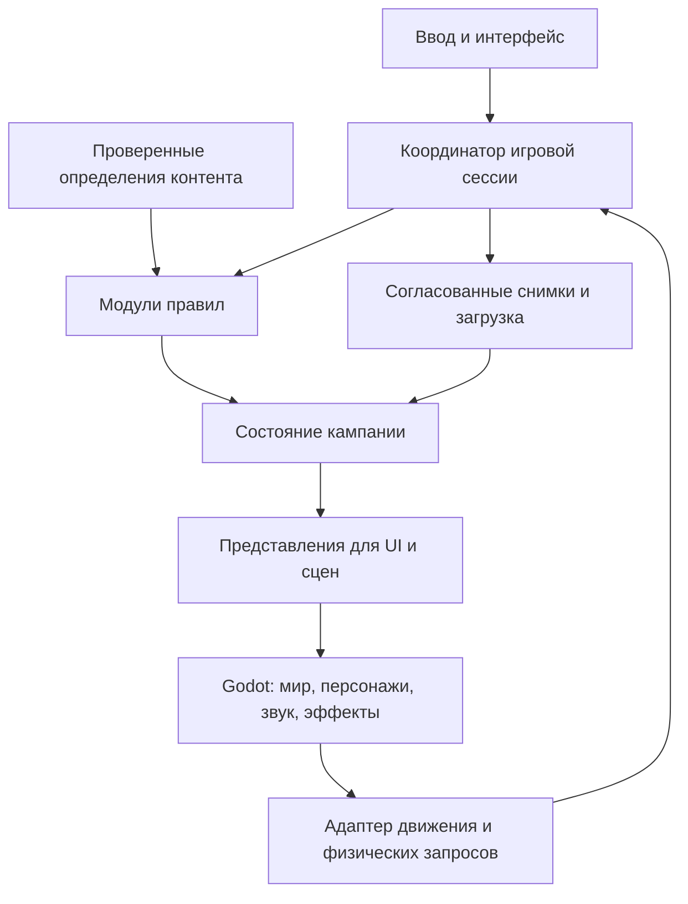

# Верхнеуровневая архитектура

**ID:** TECH-ARCH · **Version:** 0.2.1 · **Updated:** 2026-11-10.

Windows 11 development and pinned P0 tooling: [workflow](03-windows-development.md), [evidence](04-p0-validation.md). Gameplay architecture remains unchanged.
**Статус:** ACCEPTED пользователем 9 ноября 2026 года; реализация проверяется по [мастер-плану](01-master-plan.md). Игровые инварианты остаются ACCEPTED по GDD; архитектурные имена ниже не являются готовыми классами.

## 1. Архитектурная форма

Один локальный Godot-процесс, типизированный GDScript, модули по игровым обязанностям. Без серверов, микросервисов и собственного универсального движка. Правила, состояние кампании, определения контента и визуальные сцены разделены. Небольшие интерфейсы вводятся на реальных границах: хранилище, случайность, физические запросы и представление.



Стрелки показывают поток данных, не право произвольной записи. Только операция соответствующего модуля изменяет принадлежащую ему часть состояния; координатор обеспечивает согласование нескольких модулей. Сцена не выдаёт награду в `_ready()` и не хранит единственную копию жизни NPC. Сигналы Godot подходят для уведомления о совершённом изменении, но цепочка произвольных сигналов не служит транзакцией покупки или смерти.

Для правил подходят обычные типизированные классы GDScript без зависимости от дерева сцены. Они могут использовать базовые типы Godot и выполняться в безоконном процессе Godot; перенос на другой язык для тестирования не нужен. Статические определения — проверенные ресурсы/данные. Изменяемое состояние кампании не хранится в общем ресурсе шаблона.

## 2. Системы и владение состоянием

| Модуль | Отвечает за | Основные связи и границы |
|---|---|---|
| Сессия | Режим кампании, активную локацию, очередь команд, безопасные точки снимка | Управляет переходами исследования, длительного действия, боя, смерти и итогов |
| Персонаж и развитие | Душу, тело, освоение, основной метод, корни, Ци, первые рубежи, процессы преобразования | Проверяет доступность техники и процедуры; мир хранит сами предметы. [23](../23-character-system-foundations.md), [04](../04-cultivation-and-breakthroughs.md) |
| Календарь и длительные действия | Одну дату, этапы практики/пути/ремесла, границы остановки | Вызывает правила систем на значимых датах; не рассчитывает сам все рецепты и сюжетные исходы. [03](../03-time-soul-and-reincarnation.md), [21](../21-space-time-and-regional-calendar.md) |
| Мир и региональные события | Состояния мест, причинные события, ресурсы, существование NPC и организаций | Непосещённое место живёт в данных; загруженная сцена не является условием старения. [07](../07-world-calendar-and-content-generation.md) |
| Имущество и экономика | Экземпляры, количества, владельца, местонахождение, контейнеры, резервирование, конечные запасы | Передача и расход выполняются единожды; экипировка ссылается на те же экземпляры. [06](../06-resources-gathering-and-economy.md) |
| Ремесло и услуги | Этапы работ, качество, дефекты, сроки и исполнитель | Использует общий календарь и резерв имущества; знания принадлежат душе. [24](../24-professions-and-crafting.md) |
| Сюжет, отношения и договоры | Факты истории, состояние задания, условия реплик, личные и институциональные права | Читает живого NPC, текущую личность героя и физические вещи; не создаёт их по тексту диалога. [08](../08-npcs-quests-and-sects.md) |
| Локальный экшен | Движение, фазы действий, цели, попадания, защиты, полёт, тактическое поведение врагов | Общие правила на земле и в воздухе; собственное локальное время; физические запросы через адаптер. [05](../05-combat-and-exploration.md) |
| Знания и интерфейс | Датированные сведения, доступный прогноз, объяснения недоступности | Читает проекцию доступных знаний, не весь скрытый WorldState. [09](../09-ui-ux-and-feedback.md) |
| Хранение | Версии, снимок, восстановление, резерв и миграции | Не определяет новые правила смерти или случайности. [13](../13-state-data-and-save-contracts.md) |

Небольшой корень сессии связывает модули. Не нужен набор глобальных Autoload-объектов, каждый из которых может изменить всё. Объём классов определяется первым сквозным сценарием; таблица не предписывает создавать пустой каркас всех систем в VS-00.

## 3. Определения, экземпляры и команды

У типа предмета есть `definition_id`, у физического предмета — `instance_id`; у личности NPC и торговой роли разные ID. Сюжетный знак остаётся одним экземпляром при передаче между людьми и хранилищами. Устойчивые ID не выводятся из имени узла сцены, отображаемого русского имени или пути к модели.

Минимальный корень снимка содержит: ID кампании, версии схемы и контента, мировую дату, состояние души, активное/последнее тело и историю, мир и людей, имущество, знания, задания/договоры, длительные процессы, случайные потоки, активную локальную сцену и режим продолжения. Точный состав полей уточняется по первому сценарию; дублировать вычисляемый возраст и дату рождения как две независимые истины нельзя.

Принятый путь значимого действия:

1. UI отправляет намерение с устойчивыми ссылками; запрос прогноза ничего не расходует и не двигает случайность.
2. Правила возвращают доступность, известные последствия и причины неопределённости, связанные с ревизией состояния.
3. При подтверждении условия перепроверяются. Существенно изменившийся прогноз требует нового подтверждения, а не исполнения старого обещания UI.
4. Модуль готовит согласованные изменения затронутых записей; до фиксации частичный результат не виден соседним системам.
5. Фиксируется ID операции, фактический расход/результат, обновляется ревизия; уведомляются представление и сохранение. Повтор доставки этой операции не выдаёт вторую вещь.

Это локальные операции в одном процессе. Не нужны распределённые транзакции, запись каждой координаты в журнал или полное event sourcing. Для обычного движения используется фиксированный шаг экшена; для покупки и календарной границы — явная атомарная операция в памяти и согласованный снимок.

## 4. Два времени и пауза

**Календарное время:** целые дни и земная календарная структура. Продвигается подтверждёнными длительными действиями. Возраст души и тела выводится согласованно из дат. Нельзя заменить год множителем 365 или начислять возраст из времени кадра.

**Время экшена:** фиксированные шаги локального движения, атак, медитации, полёта и эффектов. Ускоренное восприятие меняет общий темп этого времени, включая приток/отток Ци, без ускорения героя относительно остальных. UI может оставаться отзывчивым по отдельному времени представления. Обычный бой не двигает календарь.

Системная пауза — отдельный режим: экшен и ресурсы не обновляются, боевые команды не принимаются и не накапливаются для исполнения после паузы. Выход/загрузка и экран продолжения используют этот режим. Изменение настроек не должно скрыто оплачивать или исполнять технику. Меню техник во время боя не выдаёт бесплатную паузу.

Календарный исполнитель проходит до ближайшей значимой даты: событие, конец этапа, встреча, готовность заказа, истечение жизни. Внутри границы проверяются актуальные предпосылки; устаревшее будущее отменяется. Готовность фонового процесса меняет мир, но не сообщает герою тайну без канала сведений. Автономная выдержка и практика за один месяц дают один месяц, не два.

**OPEN-01:** для прототипа принят пролептический григорианский календарь с днём 0 = 01.01.0000 по SPACE-03. До VS-01 оформить и проверить соглашения о неделе и 29 февраля. Истечение жизни до нового предела в тот же день уже принято TIME-08. Для зависимых событий нужна явная причинная последовательность; сортировка по ID допустима только для независимых событий. Цикл событий одной даты должен диагностироваться, а не молча обрезаться.

Для одного региона обновлять его данные при каждом значимом календарном продвижении. Проверочный второй регион может существовать только в тестовых данных: межрегиональное сообщение имеет отправителя, получателя, дату и причину и обрабатывается до зависимого события получателя. Оптимизацию отложенным расчётом вводить только при необходимости и сохранении одинаковой истории.

## 5. Воспроизводимость и случайность

Разделить генераторы случайности по игровым обязанностям и косметике. Сохранять версию алгоритма, состояния потоков и уже разрешённые значимые исходы; одного стартового seed недостаточно. Привязать результат к конкретной операции/возможности, чтобы открытие меню, повторный вход и дробление ожидания не создавали новую попытку.

Альфа использует фиксированный профиль. Вариативность не масштабирует мир под героя и не создаёт редкость заново при посещении. Новая визуальная частица не потребляет число из потока добычи. При изменении генератора либо контента нужна явная политика совместимости.

Rule reproducibility does not promise bit-identical 3D physics. Restore saved observable state and preserve resolved outcomes. Windows 11 is the required platform; cross-OS physics testing is outside the current scope. Replay is not the sole mechanism for restoring combat.

## 6. Сохранение и восстановление

Первый вариант — явный версионированный снимок в JSON с кодеками базовых типов. Это читаемый прототипный формат, не обязательный формат релиза. ID и состояние RNG при необходимости кодируются строками; целочисленные поля после разбора проверяются и приводятся явно. Векторы и перечисления имеют объявленное представление. Не сериализовать весь SceneTree, ссылки на Nodes или исполняемые Resources как состояние кампании.

Заголовок: версия схемы, версия сборки, версия/состав контентного пакета, ID кампании, последовательный номер снимка, контрольная сумма полезной части. Проверки схемы и игровых инвариантов обязательны помимо контрольной суммы. Более новую неизвестную схему не пытаться «починить» сбросом персонажа.

Запись: получить снимок на согласованной границе → записать временный файл в том же каталоге → закрыть и проверить → заменить текущее продолжение с сохранением предыдущей исправной записи. Validate the replacement/recovery protocol on Windows 11, including failure between every stage. Не обещать устойчивость к отключению питания только на основании вызова переименования. Резерв предназначен для повреждённой записи, не для выбора прежней даты игроком.

Значимые события, включая смерть, требуют немедленной записи; выход сначала останавливает игру и завершает запись. Если запись не удалась, нельзя сообщать об успешном сохранении: показать ошибку и возможность повторить, сохраняя согласованное состояние в памяти. Для обычного движения добавить периодические снимки; интервал и допустимые задержки выбрать по измерению OPEN-10. Очередь записи не позволяет более старому снимку заменить новый. При сбое допустим откат к последней успешно записанной точке по STATE-09.

**Снимок боя** включает состояние участников и тактического поведения, положение/скорость, режим полёта, выбранную цель, фазу/остаток времени действия, зафиксированную область, расходы и задержки, снаряды с траекторией/целью/сроком, защиты, эффекты, режим восприятия, уже применённые попадания и случайность. Граница снимка не оставляет урон применённым при несохранённом признаке его применения.

Порядок загрузки: проверить файл/контент → выполнить поддерживаемую миграцию на копии → восстановить состояние → загрузить нужную геометрию → создать участников и снаряды → разрешить ID-ссылки → выставить физические и анимационные фазы → показать сцену на системной паузе. До явного продолжения ни AI противников, ни физика, ни эффекты не делают игровой шаг. Контакты физического движка могут восстанавливаться; нельзя повторно применить попадание, которое уже записано.

Смерть сохраняет причину, имущество и переход к переносу. Завершённый перенос сохраняет конкретного носителя, место, дату и вещи. Нет загрузки живого старого тела после штатного выхода с экрана смерти.

**Совместимость:** в прототипе допускается объявленная несовместимость схем, но проверочные сохранения хранятся как fixtures. Перед внешней альфой выбрать обещаемую область миграций. Миграция не перезаписывает исходник до успешной проверки и не подставляет отсутствующий объект по умолчанию. Версия контента закрепляется на кампанию; позднее подключение региона требует отдельного решения.

## 7. Экшен, физика и анимация

Для героя и активных персонажей исходный кандидат — управляемый кинематический контроллер на Godot CharacterBody3D. Обычное движение, полёт и специальные перемещения используют общий контракт, но разные состояния и правила доступности. Реализацию физики проверить на закреплённой версии движка; ragdoll и сложная динамика не требуются первому срезу.

Техника описывает условия, цель/область, этап подготовки, выпуск, действие и восстановление, точки оплаты и прерывания. Игровой таймер фазы определяет попадание; анимация представляет эту фазу. Замена клипа не переносит момент урона без явного изменения карточки. Нельзя делать событие анимации единственным источником расхода или смерти, иначе загрузка/пропуск кадра изменит результат.

Наведение и объёмные запросы используют геометрию Godot; правила учитывают допустимую поверхность, высоту, препятствия и момент фиксации центра. Движение быстрого снаряда проверяет пройденный участок, а не только точку конца кадра. Конкретный способ столкновений выбирается и измеряется в VS-04.

AI противников — подготовленные конечные состояния и правила выбора, не языковая модель и не внешний сервис. У противника сохраняются текущая задача, цель и фаза атаки. Дальние/неактивные NPC представлены календарными данными; полная тактическая симуляция всего региона не запускается.

Анимационный слой получает именованные состояния и параметры; скелет, набор клипов, точки крепления и масштаб образуют контракт ассета. Пальцы, длинная одежда и оружие проверяются отдельно. Root motion допустим только с явно определённым владельцем перемещения и сохранением его прогресса; смешивать его со вторым независимым перемещением контроллера нельзя. Предпочтение первого прототипа — движение контроллером и подходящие циклы на месте.

## 8. Локации и подгрузка

Авторский регион состоит из ограниченных локаций с локальными координатами. Подгрузка не продвигает календарь; календарную цену задаёт подтверждённый маршрут. Источник ресурса создаётся из состояния экземпляра, а не из шаблона «полный при каждом входе».

Сначала загружается одна небольшая локация целиком. Ранний полётный стенд проверяет необходимость разбиения на части, дальность видимости и переходы. Если нужна подгрузка внутри локации, части пространства имеют стабильные ID и диапазоны активации; отсутствие декоративной геометрии и отсутствие игрового состояния различаются. Нельзя выгрузить летящий боевой снаряд или активного врага без сохранения его состояния либо явного удержания области.

Предзагрузка учитывает максимальную проверяемую скорость и дистанцию торможения. При задержке загрузки нельзя проваливаться через ещё не созданную коллизию; конкретная политика перехода проверяется на стенде. Ландшафтный плагин, HLOD и потоковая загрузка выбираются по измеренной необходимости. Большая карта и double-precision сборка не вводятся заранее.

## 9. Подготовленный контент и сюжет

Принят текстовый авторский формат JSON с проверкой схем для карточек, событий и диалогов; Godot Resources используются для привязок сцен, материалов и иных редакторских ресурсов. Один набор фактов не редактируется одновременно в JSON и `.tres`: если нужна конверсия, производная часть генерируется воспроизводимо. Конкретный формат закрепить после малого сюжетного пакета.

Условие диалога — небольшой типизированный набор проверок (живой участник, знакомство с текущим телом, знание, владелец ключа, стадия истории). Последствие вызывает допустимую команду модуля. Текст не исполняется как код; не нужен произвольный язык сценариев для первого среза. Если типовой формат не выражает реальный сюжет, расширяется конкретная операция либо выбирается проверенное дополнение после испытания.

Факты мира, журнал героя и текст реплики раздельны. Ло Вэй не может говорить после смерти; Инь Цю не наследует его секрет и обещание. Знак, возвращённый Ло Вэю, физически находится у него; смерть до передачи не создаёт знак в сумке героя. Скрытый зал проверяет предмет и доступ, а не только флаг «прочитал подсказку».

Карточка события содержит ID, дату/условие, зависимости, область чтения/изменения, исход без игрока, отмену, однократность и канал знания. Валидатор проверяет ссылки и типы; сценарные тесты — достижимость нужных ветвей, смерть участников и однократность награды. Автоматическая проверка не доказывает художественное качество диалогов: это предмет пользовательского ревью и плейтеста.

Тексты получают устойчивые ключи отдельно от игровых ID. Русский принят для прототипа; языки выпуска ещё не выбраны. Строки UI не собираются конкатенацией фрагментов, затрудняющей перевод. Голосовые файлы привязываются к ключу/версии реплики, не определяют её последствия. Подготовка перевода не означает производство нескольких языков сейчас.

## 10. Ввод и доступность

По T-003/011 принят минимальный набор: переназначение игровых действий клавиатуры/мыши, чувствительность и инверсия камеры, регулировка масштаба текста/UI, отдельные громкости, субтитры при наличии речи, отключение тряски и уменьшение вспышек, важные сигналы через форму/текст и звук. Удержание/переключение для длительно удерживаемых режимов проверять на удобство без изменения цены техники.

Настройки хранятся отдельно от кампании. Меню настроек не позволяет назначать боевые действия на системной паузе. Доступность не вводит автоматическую защиту, QTE или новые правила времени. Минимум интерфейса проверяется с VS-02; полный набор постепенно завершается до P10. Геймпад сейчас не реализуется, но код работает с именованными действиями ввода, а не сырыми клавишами внутри боевых правил.

## 11. Инструменты и воспроизводимость сборки

**Godot — ACCEPTED, T-009/010:** целевая ветка 4.8 Standard, типизированный GDScript. Для VS-00 допустима 4.8 beta 2, если к началу этапа нет более подходящего проверенного выпуска. P0 pins Godot 4.8 beta 3 Standard and matching Windows x86-64 templates in `tools/toolchain.json`, after import, headless and Windows runtime checks. Use the same lock on any development machine. Обновлять beta по конкретной причине с проверками, не автоматически. Feature-complete не означает отсутствие регрессий; дата stable не является зависимостью начала архитектурной работы или ранних 3D-стендов. [Объявление beta 2](https://godotengine.org/article/dev-snapshot-godot-4-8-beta-2/).

Переход на stable — отдельная ветка и регрессия календаря, сохранений, импорта, фаз анимации/боя и Windows-экспорта. При блокирующей ошибке beta подготовить минимальное воспроизведение, проверить исправление; 4.7.2 допускается как запасной вариант. Одновременная поддержка двух версий не требуется. Minor-обновления обычно не требуют существенного переноса, но изменения поведения проверяются на проекте; автоматические проверки API не заменяют эту регрессию. [Политика выпусков](https://docs.godotengine.org/en/stable/about/release_policy.html).

**Рендерер:** исходный кандидат для B — Forward+; проверить облегчённый профиль на A. Compatibility исследовать как запасной вариант для разработки, не обещая паритет эффектов и не превращая его автоматически во второй поддерживаемый рендерер выпуска. Выбор фиксируется по стенду. Godot различает рендереры и графические драйверы; их фактические сочетания нужно записывать в результатах. [Документация рендереров](https://docs.godotengine.org/en/stable/tutorials/rendering/renderers.html).

**Blender и обмен:** закрепить стабильную версию после проверки импорта. Принято хранить исходный `.blend` вне каталога игры, а в сборку передавать подготовленный GLB/glTF 2.0. Godot рекомендует glTF; прямой `.blend`-импорт вызывает установленный Blender. Явный экспорт уменьшает зависимость сборки игры от окружения производства. FBX из библиотеки допустим как исходник, конверсия проверяется на сохранение всех клипов. [Форматы Godot](https://docs.godotengine.org/en/stable/tutorials/assets_pipeline/importing_3d_scenes/available_formats.html).

**Инструменты разработки:** небольшой набор Python-скриптов для валидации, упаковки и отчётов; существующий валидатор GDD сохраняется. Логические тесты выполняются GDScript в Godot. Сторонний тестовый фреймворк выбирается только при конкретной пользе. В безоконном режиме проверяются правила/импорт, но не качество графики.

**Структура, создаваемая в VS-00:**

```text
docs/technical/             технические документы
game/project.godot         игровой проект
game/src/domain/           правила и типизированное состояние
game/src/application/      координация команд и сессии
game/src/infrastructure/   запись, загрузка, адаптеры
game/scenes/               представление и игровые локации
game/content/              определения и привязки контента
game/assets/               подготовленные ассеты для импорта
game/tests/                правила, fixtures и проверочные сцены
art/source/                исходники производства, по выбранной политике хранения
tools/                     проверки и сборка
```

Это схема будущих путей, не требование создать сейчас все каталоги. `.godot/`, временные генерации, ключи сервисов и сборки не коммитятся как исходники. Небольшие `.uid` и импортные настройки, требуемые закреплённой версией Godot, сохраняются по её правилам контроля версий.

Будущий интерфейс команд: импорт проекта, запуск логических тестов, экспорт профиля Windows. В VS-00 записать точные работающие команды с путём к бинарнику, кодами завершения и логами. Командная строка Godot поддерживает безоконную работу и экспорт; наличие успешно созданного `.exe` не заменяет его запуск на Windows. [Документация CLI](https://docs.godotengine.org/en/stable/tutorials/editor/command_line_tutorial.html).

## 12. Замена ассетов и внешних сервисов

Для принятого ассета хранить: внутренний ID, происхождение/поставщика, версию, условия использования и подтверждение получения, исходник, подготовленный файл и контрольную сумму, масштаб/оси, материалы, скелет/клипы, коллизии и результаты проверки. Лицензию конкретной библиотеки проверять перед включением; общий отзыв о сервисе не является лицензией файла.

Генераторы работают только при разработке. Их ответы не являются частью запуска игры; секреты и сетевые клиенты не входят в игровой runtime. Изменение генератора не меняет формат команды боя или состояние кампании. Сохраняется принятый результат, а не надежда повторить его одним prompt после обновления сервиса.

Временный и окончательный визуальный вариант реализуют одинаковый контракт: размеры/точки крепления, нужные клипы и параметры материалов. Сохраняемые ссылки указывают на внутренний ID определения, а не на название файла, выданное сервисом. Коллизии и время фаз проверяются отдельно от красоты. Замена изображения не должна скрыто улучшать дальность удара или менять проходимость места.

Основания исследовательского списка: [игровые GLB в документации Higgsfield](https://github.com/higgsfield-ai/skills/blob/main/higgsfield-websites/references/game-3d-animation.md), [Tripo](https://www.tripo3d.ai/help/getting-started/what-features-does-tripo-have), [Meshy](https://docs.meshy.ai/en/webapp/guides/3d-model/rigging), [Cascadeur](https://cascadeur.com/help/faq), [DeepMotion](https://www.deepmotion.com/animate-3d), [Seedance 2.5](https://seed.bytedance.com/en/seedance2_5). Проверены публичные описания, а не собственные производственные результаты. Конкретные модели, тарифы и доступность повторно проверяются перед испытанием; фиксировать все эти сервисы зависимостями проекта сейчас не нужно.

## 13. Наблюдаемость и проверка архитектуры

Каждая проверочная сборка содержит версию, профиль контента, seed и настройки стенда. Логи операций включают ID команды, дату/шаг, причину отказа и затронутые ID; скрытые сведения доступны только в отладке. Отчёт ошибки должен позволять приложить согласованный снимок и повторить сценарий. Телеметрия сначала локальная; внешний сбор данных не вводится.

Проверки делятся на правила без 3D, интеграционные сцены, экспорт и запуск на целевой ОС, аппаратные измерения и плейтест. Сначала проверять риск конкретной задачи; полную регрессию применять при изменении состояния/календаря/сохранения или перед этапным решением. Проверки графики и удобства не заменяются сравнением JSON.

Обязательные архитектурные сценарии: многолетнее действие с событием внутри; один и тот же мир при дроблении ожидания; повторный рубеж; передача единственной вещи; параллельный заказ; загрузка перед попаданием; смерть и перенос; уничтоженный NPC и его сюжет; замена модели без потери состояния. Карта этапов и AT-сценариев находится в мастер-плане.

## 14. Решения, которые ещё предстоит доказать

| Вопрос | Рабочее направление | Момент решения |
|---|---|---|
| Версия/рендерер/импорт | Закреплённый выпуск Godot 4.8, beta допустима для прототипа; GLB, профиль B | VS-00, повторная проверка на полётном стенде |
| OPEN-01: даты и совпадения | Явная календарная политика и причинные зависимости | До календарного исполнителя VS-01 |
| OPEN-10: запись и миграции | Снимок, временная запись, резерв, проверка загрузки | VS-01; расширение на бой VS-04; политика внешней альфы P8 |
| Динамическое восстановление | Явные фазы, сохранённый экшен, загрузка на паузе | Ранний стенд и VS-04; блокирует расширение боя |
| Формат сюжета/данных | Малый декларативный набор и типизированные операции | Первая ветка знака VS-02, до массовых диалогов |
| Подгрузка/ландшафт | Локация целиком сначала; разбиение по измерению | VS-02/04, до массовой географии |
| Бюджеты производительности | Измерения двух машин; предварительная цель B | VS-02/04; минимум игрока отдельно |
| Языки, стиль, голоса | Русский прототип, ключи текстов, временное оформление | До массового производства текстов и художественного этапа |
| Социальные критерии и баланс | Малые явные карточки по OPEN; без скрытого принятия формул | До соответствующего функционального сценария |

Документ достаточно конкретен для постановки VS-00 и подготовки детализации VS-01. Он не утверждает, что движок уже испытан, формат сохранения окончателен или карточки поздних стадий готовы. Изменение проверенного технического решения сопровождается результатом испытания и оценкой влияния на контент и сохранения.
